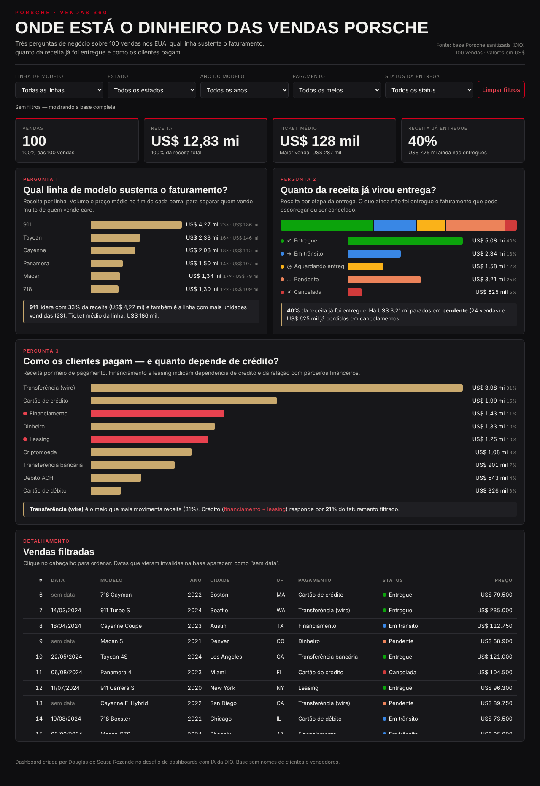
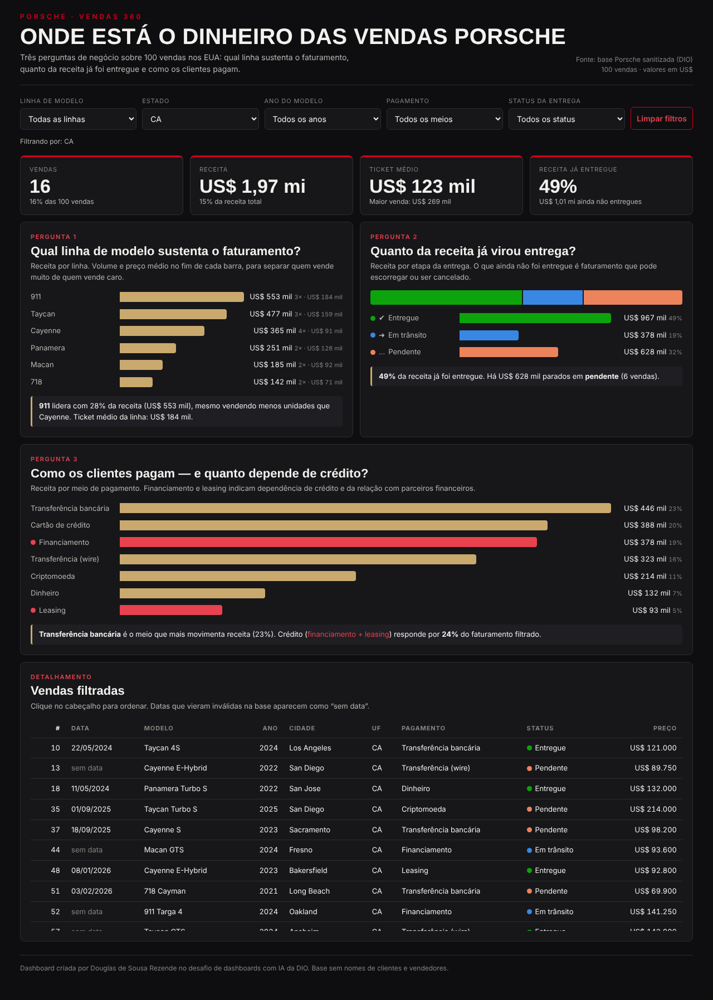
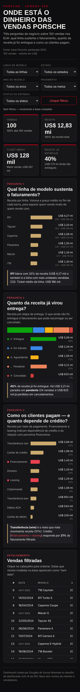

# 🏎️ Porsche Vendas 360 — Dashboard interativa

Dashboard em HTML (arquivo único) que transforma uma planilha de **100 vendas da Porsche** em respostas para três perguntas de negócio, com filtros, indicadores de topo e publicação no GitHub Pages.

### 🔗 Dashboard publicada: **https://SEU_USUARIO.github.io/dashboard-porsche-vendas/**



---

## ❓ Perguntas de negócio — e por que escolhi cada uma

| # | Pergunta | Por que importa | Resposta (base completa) |
|---|---|---|---|
| 1 | **Qual linha de modelo sustenta o faturamento?** | Volume e receita contam histórias diferentes. Saber quem traz dinheiro (e não só quem vende mais) orienta estoque e campanhas. | A linha **911** gera **33% da receita** (US$ 4,27 mi) com ticket médio de US$ 186 mil. |
| 2 | **Quanto da receita já virou entrega?** | Venda fechada não é receita garantida. Venho da área de produção e qualidade, onde o que importa é o que sai da linha. Aqui é o mesmo: o que ainda não foi entregue é risco. | Só **40%** da receita já foi entregue. **US$ 3,21 mi** estão pendentes e **US$ 625 mil** foram cancelados. |
| 3 | **Como os clientes pagam — e quanto depende de crédito?** | Mostra a dependência de parceiros financeiros e ajuda a planejar condições comerciais. | Transferência (wire) lidera com 31%. **Financiamento + leasing = 21%** da receita. |

Cada gráfico tem, logo abaixo, um **texto que responde à pergunta automaticamente** com os números do filtro aplicado.

---

## 🎛️ O que a dashboard tem

- **Filtros:** linha de modelo, estado, ano do modelo, meio de pagamento e status da entrega + botão *Limpar filtros*.
- **Indicadores de topo:** vendas, receita, ticket médio e % da receita já entregue.
- **Três gráficos**, um por pergunta, com tooltip ao passar o mouse.
- **Tabela de detalhamento** ordenável por qualquer coluna.
- **Visual:** inspirado na Porsche — grafite escuro, vermelho Porsche `#d5001c` como destaque, barras em champanhe; títulos em *Barlow Condensed* e texto em *Inter*. Responsiva no celular.
- **Sem bibliotecas de gráfico:** barras desenhadas em HTML/CSS, então o arquivo abre rápido e não quebra se um CDN cair.

### Exemplo de filtro aplicado — Estado = CA



Na Califórnia o 911 continua liderando em receita (28%), **mesmo vendendo menos unidades que o Cayenne**. A dependência de crédito sobe para 24%.

<details><summary>📱 Versão no celular</summary>


</details>

---

## 🧹 Tratamento da base antes de ir para a IA

A planilha original traz cada campo em duas versões: o dado cru e o sanitizado. O tratamento foi:

1. **Fiquei só com as colunas sanitizadas** (`*Sanitized`) e descartei as cruas, como `$121k`, `twenty twenty four` e `delivered!!!`.
2. **Removi dados pessoais:** `customer_name` e `salesperson` saíram da base. A base vai embutida no HTML público, então nenhum nome de pessoa pode ir junto.
3. **Converti para número:** `preco` e `quilometragem_mi` viraram decimal/inteiro e `ano_modelo` virou inteiro. A base final só tem valores, sem fórmulas.
4. **Datas inválidas:** 24 vendas vieram como `INVALID` (ex.: `2024-02-30`, `April 31st`). Mantive as vendas, deixei a data vazia e a dashboard mostra "sem data". Nenhum filtro depende da data, para não perder 24% da base.
5. **Criei duas colunas de agrupamento:**
   - `familia`: as 40 versões viraram 6 linhas (911, 718, Cayenne, Macan, Panamera, Taycan). Com 40 modelos para 100 vendas, quase todo modelo teria 1 a 4 vendas e o gráfico não diria nada.
   - `status_grupo`: os 10 status foram reunidos em 5 etapas (ex.: *Shipped* e *In Transit* → Em trânsito; *Pending Approval* e *Pending Review* → Pendente).

Base tratada: [`data/porsche_vendas_tratada.csv`](data/porsche_vendas_tratada.csv) (também em [.xlsx](data/porsche_vendas_tratada.xlsx)).

---

## 🤖 Como a dashboard foi gerada

Usei um **assistente de IA conversacional (Claude)**, no mesmo fluxo que o curso mostra no ChatGPT com Canvas:
prompt com as perguntas, os filtros e a referência visual → geração do HTML → refinamento em linguagem natural → teste no navegador → publicação.

- O prompt completo e cada refinamento até a versão final estão em **[`prompt.md`](prompt.md)**.
- Principais ajustes: padronização da moeda (`US$ 12,83 mi`), correção de um estouro de largura no celular, rótulos cortados nas barras e a troca de "em aberto" por "não entregues" no KPI (o valor incluía vendas canceladas).

---

## 🗂️ Estrutura do repositório

```
dashboard-porsche-vendas/
├── index.html                     ← a dashboard (arquivo único, dados embutidos)
├── prompt.md                      ← prompt inicial + refinamentos
├── README.md
├── data/
│   ├── porsche_vendas_tratada.csv
│   └── porsche_vendas_tratada.xlsx
└── images/
    ├── dashboard-completa.png
    ├── filtro-california.png
    └── mobile.png
```

## 🚀 Como publicar (GitHub Pages)

1. Suba os arquivos para um repositório público.
2. Em **Settings → Pages**, escolha *Deploy from a branch*, branch `main`, pasta `/ (root)` e clique em **Save**.
3. Depois de 1 a 2 minutos, a dashboard fica no ar em `https://SEU_USUARIO.github.io/dashboard-porsche-vendas/`.

## 💡 Próximos passos

- Criar uma segunda regra de tratamento para recuperar as 24 datas `INVALID` e liberar a análise por mês.
- Montar um agente com duas skills: uma que trata o dado e outra que desenha a dashboard.
- Comparar o resultado com uma versão no estilo dos componentes do Power BI.

---

👤 **Douglas de Sousa Rezende** — Inspetor de END (aviação) · Estudante de Engenharia de Produção
